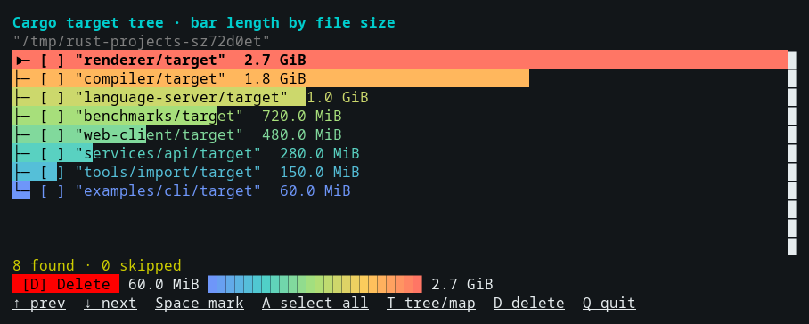
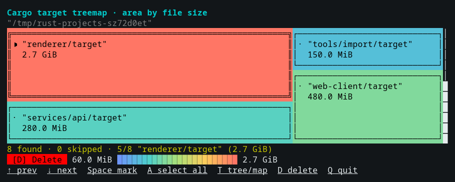

# targetscan

Find Cargo build directories, compare their sizes, and choose which ones to delete. The tree opens with the largest target first. Press **T** to switch to a treemap, where block area represents size.





## Run

Download a binary for your platform from [GitHub Releases](https://github.com/kxxt/targetscan/releases), or run from a source checkout with `cargo run --release -- [DIRECTORY]`. Omit the directory to scan the current one.

```sh
targetscan ~/projects
```

## Controls

Use the arrow keys or mouse wheel to move. Press **Space** to mark or unmark a target, **A** to select all, or **Esc** to clear marks. The footer shortcuts are also clickable.

Press **D** to review the marked paths. With no marks, it opens the focused target for review. **Y** confirms permanent deletion and **Esc** cancels. You can keep browsing while deletion runs. Press **Q** to quit.
